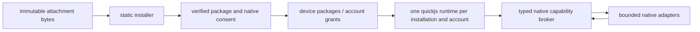

# javascript plugins: implementation contract

status: implementation in progress. this document defines contracts, not verified application behaviour.

## ownership and flow

the base is origin/master at 768d2d698502d06c9ed6842f1f2b774b87bb0a75, in branch feat/js-plugins. the original worktree's changes are unrelated and must remain untouched. ios minimum is 15.0 (Telegram/BUILD). native execution uses the vendored interpreter, no jit entitlement or helper process.

## trust boundary

all package bytes, metadata, javascript and callback arguments are hostile. preview never creates a runtime. one separate JSRuntime belongs to each installation/account pair. queues isolate scheduling, not native memory corruption. interpreter or image-decoder defects remain in the threat model.

the bridge accepts only json method/parameter envelopes. native closures bind installation identity, account scope and generation; javascript never supplies identity. no account, postbox, mediabox, mtproto transport, native pointers, reflection or arbitrary selectors cross the bridge. authorization, account destruction, security settings, payments, gifts, paid sends, deletion/moderation and raw requests have no methods. signatures attest publisher/content, not safety.

localPrivate and publicNetwork are mutually exclusive execution profiles. private text cannot use generic network, external navigation, clipboard, share, notifications, exported files, logs containing payloads or cross-plugin communication. sensitive service/auth sources are excluded before snapshots. selected content sent to a named external service requires its own native confirmation. unavailable adapters fail with feature_unavailable; the sdk must expose availability rather than invent successful effects.

## formats

schemaVersion 1, apiVersion ^1.0.0. .donut.js begins with `const _plugin = "donutgram";`, followed by a static `const manifest =` json-compatible object. no evaluation, getters, spreads, duplicate keys or expressions are accepted in metadata. .dgplugin is a bounded zip containing manifest.json, main.js and optional relative source/assets paths. imports resolve only installed normalized package paths, never network, std/os, node or bytecode. ordinary .js remains a document.

manifest fields: kind, schemaVersion, id, name, version, description, author, apiVersion, minClientVersion, entry, icon, permissions, optionalPermissions, settingsSchema, profile, changelog. unknown fields are rejected. id is reverse-domain; versions are semver. profile defaults to localPrivate. permissions contain capability, scope, reason and optional origins. origins are normalized exact https origins. settings are bounded declarative values. optional broken icons fall back to a puzzle symbol.

DGPluginJSON is a Codable, Equatable enum (null, bool, number, string, array, object). DGPluginPermission is Codable and Hashable (capability: String, scope: String, reason: String, origins: [String]). DGPluginManifest is Codable and Equatable. DGVerifiedPluginPackage is an immutable value containing manifest, files: [String: Data], digest: String, publisherIdentity: String, trust: String and originalData: Data. DGPluginInstaller.preview(data:fileName:) throws returns this value. package files and original bytes are verified once and reused on install.

signed packages require Ed25519 and canonicalization dg-canonical-v1 in signature.json. DGPluginCanonicalJSON emits tagged binary manifest bytes with binary64 numbers, UTF8 byte-counted strings and UTF8-sorted object keys; the signature payload hashes those bytes for manifest.json and exact bytes for every other installed file. missing/unknown canonicalization fails before cryptographic verification. authoring.md defines the normative grammar and cross-tool fixture; the format replaces the unreleased platform-dependent JSONEncoder signature path.

installation records contain an opaque uuid, manifest, digest, publisher, code version and durable removal state. account records contain enabled, exact grants, settings and storage. adding permissions/origins/profile requires new consent. unsigned replacements require explicit review; matching id/username is never publisher proof. removing is persisted before any cleanup; restart resumes cleanup and never activates removing records. starting runtimes are listed in running.json until ten seconds after a successful activation; a launch that finds one still listed turns that plugin off instead of starting it. writes use same-volume atomic replacement and rollback keeps the previous compatible record.

## runtime contract

DGPluginRuntime is a Foundation-only Swift wrapper around a private c host. initializer: `init(files: [String: Data], entry: String, environmentJSON: String, request: @escaping (String, @escaping (String) -> Void) -> Void) throws`. methods: `start(completion: @escaping (Result<Void, DGPluginRuntimeError>) -> Void)`, `dispatch(kind: String, payloadJSON: String, completion: @escaping (Result<Void, DGPluginRuntimeError>) -> Void)`, `stop()`. all engine access and destruction occur on its own thread with a 4 MiB stack (DGPluginRuntimeThread), so quickjs's stack limit is reached before the real stack ends. stop latches immediately and interrupts execution; late replies are ignored.

request envelope: `{id: number, method: string, params: object}`. response: `{result: json}` or `{error: {code: string, message: string}}`. the closure captures trusted identity; ids only match outstanding promises. start succeeds only after activate settles. dispatch kind command uses `{id: string, input?: json}`; event uses `{name: string, payload: json}`. trusted bootstrap supplies definePlugin, promises, events and typed method wrappers. package modules never execute during preview.

heap 16 mib, stack initially 512 kib, source/package limits before allocation, activation budget 1 s and callbacks 250 ms of thread cpu time with a looser wall-clock backstop, bounded pending jobs/requests/timers/contributions. a rejected command, event, callback or transform is reported with its code and keeps the runtime; a rejected activation, exceeded budgets and memory stop it. dynamic eval and all function constructor variants are denied by an opt-in context engine policy, leaving existing widgets unchanged. cancellation and memory exhaustion are final. native builtins require hostile-fixture verification; hard wall deadlines cannot be claimed from a poll-only interpreter.

## host and ui contracts

DGPluginManager is serialized and publishes immutable DGPluginInstallation snapshots on the main queue through `observe(_:) -> UUID`, `removeObserver(_:)`. factory `shared(accountKey: String)`. public snapshot properties `installations: [DGPluginInstallation]`, `globallyEnabled: Bool`; actions `install(_:completion:)`, `setEnabled(id:enabled:completion:)`, `setGloballyEnabled(_:)`, `setGrants(id:permissions:completion:)`, `updateSettings(id:values:completion:)`, `remove(id:completion:)`, `runCommand(installationId:commandId:input:completion:)`. completions use Result<Void, DGPluginError>, except install returns Result<String, DGPluginError> with installation id. `commands` contains host-validated descriptors with installationId, id, title, placement. id and generation are host-bound.

DGPluginInstallation exposes the installation identity, manifest/digest/trust, enabled/state, grants/settings and lastError, together with native diagnostics/rollback state. manager `nativeRequest: ((String, String, DGPluginJSON, @escaping () -> Bool, @escaping (Result<DGPluginJSON, DGPluginError>) -> Void) -> Void)?` receives installationId, method, params, validity and completion. the app owns the adapter; identity never comes from javascript. every completion is checked again and adapters must check validity immediately before side effects. no adapter means explicit unavailability. settings persist without executing code.

manager `nativeRender: ((String, DGPluginJSON, String, @escaping () -> Bool, @escaping (String) -> Data?, @escaping (String, DGPluginJSON) -> Void, @escaping () -> Void) -> Result<() -> Void, DGPluginError>)?` receives installationId, page, pluginName, validity, assetProvider, callback and onClosed. success returns the native cleanup closure. one owned page may be open per runtime; replacements use a fresh token, and a rejected replacement preserves the previous page's token. closure/disposal/stop invalidates callbacks and runs cleanup. assets.image returns an opaque handle for a verified installed raster; only the host's assetProvider resolves it. theme.contribute stores one of four accent names and overwrites the reserved __dgThemeTokens page field before rendering; author-supplied tokens have no authority.

native events carry `{id,timestamp,version:1,data}` with timestamp in seconds and bounded/coalesced pending delivery. only currently produced names are subscribable: plugin.activated, account.contextChanged, app.foreground, theme.changed, locale.changed, chat.opened, chat.closed, composer.changed and message.observed. payload-specific grants and current generations are checked before delivery. background/power-saving/deactivation final-event delivery and edited/deleted/selection/reachability publishers are not advertised.

profile and chatList transforms receive bounded snapshots and return typed patches; native cache/validation never waits synchronously for javascript. priority is deterministic, every composition revalidates the patch, pinned chats and nonempty panes remain protected, and stop/revocation invalidates cached results. displayLinks has a reserved schema and pure validator but no current native renderer; registration is explicitly unavailable.

ui belongs to DGPluginsUI: `dgPluginsController(context:) -> ViewController`, `dgPluginInstallController(context:package:) -> ViewController`, `dgOpenPluginDocument(context:file:present:presentOverlay:) -> Bool` (resource data through TelegramEngine.Resources; no new postbox imports). installation uses a bottom sheet with name, author/version, description, enable-after-install and one install/update action. the switch starts on; activation grants required capabilities against the exact reviewed digest, while the low-level install still stores disabled code without grants. technical trust/profile/digest fields stay out of the ordinary interface. installed cards combine icon, author/version/state, a switch, description and separate settings/share/remove actions. details retain advanced feature controls, diagnostics, rollback and publisher blocking. sharing exports verified original package bytes without execution or private plugin data. uninstall requires native confirmation and warns that all account-local data for this installation is removed. installation has no url importer or file-picker route; the separately granted files API only selects text data. the settings row is in the extensions group and includes running count/global-stop status.

## capability registry

| family | scope | initial policy |
|---|---|---|
| ui.contribute | settings, composer, selection, messageMenu, chatToolbar | bounded owned contributions |
| ui.transform | profile, chatList; reserved displayLinks | typed local models; displayLinks registration unavailable |
| theme.read / theme.contribute | currentTheme / localTokens | safe snapshot / fixed accent for owned plugin pages |
| composer.read / composer.transform | activeComposer | native gesture, handle and revision compare-and-set |
| messages.selection.read | activeSelection | native gesture, excludes protected/service sources |
| messages.read | selectedChats | bounded approved snapshots; no history export |
| chats.metadata.read / peers.read | selectedChats / selectedPeers | bounded display dto |
| storage.local | pluginAccount | 5 mib, no paths |
| network.public | declaredOrigins | publicNetwork only; exact origins, numeric DNS pinning, original TLS hostname, redirects denied |
| translation.request | selectedText | named-service confirmation |
| navigation.open | safeScreens | enumerated native screens, no arbitrary url |
| notifications.local | pluginAccount | explicit native consent; no private payload |
| files.userSelected | selectedFile | expiring opaque handle |
| messages.compose / messages.sendInteractive | chosenRecipient | native immutable preview; paid recipients always denied |

the registry advertises implementation availability per method. no capability can enable forbidden effects. grants match declared capability/scope/origins exactly and cannot widen on updates. pending operations validate generations after asynchronous work and before committing.

## connections and verification

settings: Donutgram/DGSettingsUI/Sources/DGSettingsController.swift, DGSettingsSearch.swift, DGSettingLinks.swift. document tap: submodules/TelegramUI/Sources/OpenChatMessage.swift (.document after immediateShare handling). resource reads: TelegramEngine/Resources/TelegramEngineResources.swift. composer undo-aware seam: TelegramUI/Sources/Chat/ChatControllerLoadDisplayNode.swift updateTextInputStateAndMode. selected text: ChatMessageActionOptions.swift performTextSelectionAction. thumbnail: ChatMessageInteractiveFileNode.swift. framework exports: Telegram/BUILD.

schema changes require a new schemaVersion; additive api uses semver feature availability. no automatic grants or startup on migration. incompatible records remain disabled. manual update preserves previous code/data until reviewed atomic commit; failed activation is visible and never silently reports running. rollback restores one eligible prior package/account snapshot while disabled and intersects grants with those still retained; reset discards that snapshot so rollback cannot resurrect erased data. profile changes require removal and a fresh installation. general versioned data migration is not implemented.

implementation order: static model/installer; bounded runtime; broker/manager; ui and document integration; useful composer/selection/profile adapters; sdk/tooling/fixtures; independent review and fixes. file ownership is disjoint per agent. the primary agent integrates and reviews all changes.

acceptance: document preview without execution; install disabled; explicit grants; useful command; settings persistence; stop invalidates all resources; account switch suppresses stale callbacks; reviewed update; durable removal and clean reinstall. negative tests exercise real engine/broker/installer. full ios build and recorded-frame checks remain required. windows currently has no xcode/simulator, so source-level checks do not prove ios ui or animations.

distribution: the sideload build can opt into the interpreter. app-store builds must compile external-plugin execution out until distribution compliance is established. reviewed 2026-11-08: https://developer.apple.com/app-store/review/guidelines/ sections 2.5.2 and 4.7, including 4.7.2 native api permission, 4.7.3 per-software consent and 4.7.4 index/universal links. this design does not assert app-store acceptance and uses no review-evading server flag.
